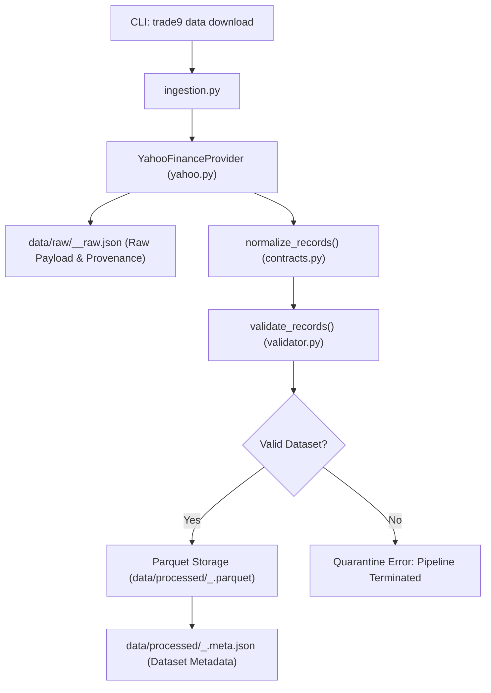

# TRADY Phase 3.1: Real Historical Market Data Ingestion & Validation

## 1. Overview & Research Scope

TRADY Phase 3.1 introduces a **reliable, reproducible real historical market-data ingestion and validation workflow** using Yahoo Finance (`yfinance`). 

### Core Research Principles:
1. **Historical Research Only**: Yahoo Finance data is treated strictly as an educational and research-grade data source, not as an official low-latency exchange feed.
2. **Zero Live Trading**: TRADY maintains its strict safety firewall. No live broker execution, order routing, or real-money trading is implemented.
3. **Pluggable & Replaceable Provider**: Built on the canonical `MarketDataProvider` protocol so downstream feature engineering, models, and backtests remain agnostic to the upstream provider.
4. **Strict Immutability & Quarantine**: Invalid datasets (e.g., negative prices, corrupted bars, high < low) are quarantined and prevented from entering the processed pipeline.
5. **Full Provenance & Overwrite Guards**: Every ingestion logs complete retrieval provenance, requested vs. actual dates, and SHA-256 checksums. Existing files are never silently overwritten without an explicit `--overwrite` flag.

---

## 2. Architecture & Directory Structure

```
trady/
├── src/trady/
│   └── data/
│       ├── contracts.py       # Canonical OHLCVRecord & MarketDataProvider Protocol
│       ├── yahoo.py           # YahooFinanceProvider adapter wrapping yfinance
│       ├── validator.py       # Validation logic (invariants, holidays, session gaps)
│       ├── ingestion.py       # Download, normalize, quarantine, and storage pipeline
│       ├── storage.py         # Parquet & DuckDB storage engine
│       └── cli.py             # CLI parser (`trade9 data download ...`)
├── tests/
│   ├── test_yahoo_provider.py # 100% offline mocked unit & pipeline tests (+ optional live test)
│   └── test_cli.py            # CLI integration tests
└── docs/
    └── phase_3_1_historical_data.md
```

---

## 3. Data Flow & Provenance Tracking



### Provenance Metadata Captured:
* **Provider**: `yahoo_finance`
* **Requested Symbol & Returned Symbol**: e.g. `^NSEI` (NIFTY 50)
* **Requested Dates & Actual Dates**: e.g. requested `2023-01-01` to `2024-01-01`, actual `2023-01-02` to `2023-12-29`
* **Retrieval Timestamp (UTC)**: ISO 8601 timestamp of data pull
* **Interval & Timezone**: Daily (`1d`), normalized to `UTC`
* **Price Adjustment**: `auto_adjust=False` (default, preserves raw OHLC) or `True`
* **SHA-256 Checksum**: Cryptographic hash of the raw response payload

---

## 4. Validation Rules & Session Gap Heuristics

1. **OHLC Integrity**: Checks $High \ge Open$, $High \ge Close$, $Low \le Open$, $Low \le Close$, and $High \ge Low$.
2. **Positive Pricing & Volume**: Rejects prices $\le 0$ or volume $< 0$.
3. **Strict Chronological Monotonicity**: Timestamps must be strictly ascending with no duplicates.
4. **Missing Values**: Bars with missing/NaN OHLCV attributes are rejected.
5. **Exchange Calendar vs. Suspicious Gaps**:
   - Weekends (1–2 calendar days) are normal non-trading intervals.
   - Standard 1–2 day market holidays (e.g., Diwali, Christmas) are treated as expected closures.
   - Calendar gaps spanning **3 or more consecutive business days** trigger a `WARN_TRADING_SESSION_GAP` diagnostic warning for researcher audit.
6. **Date Range Warnings**: Discrepancies exceeding 7 calendar days between requested and actual dates trigger `WARN_DATE_RANGE_MISMATCH`.

---

## 5. Command-Line Usage

### Dry-Run / Preview Mode
Inspect the top 5 and bottom 5 rows without writing anything to disk:
```powershell
uv run trade9 data download --symbol ^NSEI --start 2023-01-01 --end 2024-01-01 --preview
```

### Download Historical Data
Download and store daily OHLCV bars:
```powershell
uv run trade9 data download --symbol ^NSEI --start 2023-01-01 --end 2024-01-01
```
Files created:
- Raw payload: `data/raw/nsei_1d_raw.json`
- Processed Parquet: `data/processed/nsei_1d.parquet`
- Metadata: `data/processed/nsei_1d.meta.json`

### Overwrite Protection
If a dataset already exists, running the download command again will safely abort. To intentionally overwrite:
```powershell
uv run trade9 data download --symbol ^NSEI --start 2023-01-01 --end 2024-01-01 --overwrite
```

### Inspect and Validate Processed Data
```powershell
# Display schema, row counts, and summary statistics
uv run trade9 data inspect data/processed/nsei_1d.parquet

# Run rigorous invariant validation
uv run trade9 data validate data/processed/nsei_1d.parquet
```

---

## 6. Testing & Offline Guarantees

All unit tests run completely offline with mocked `yfinance.Ticker.history` responses. No external network connection is required during CI or standard test execution:

```powershell
# Run the test suite (100% offline)
uv run pytest tests/test_yahoo_provider.py

# Optional: Run live integration test against Yahoo Finance (requires internet)
uv run pytest -m network tests/test_yahoo_provider.py
```
