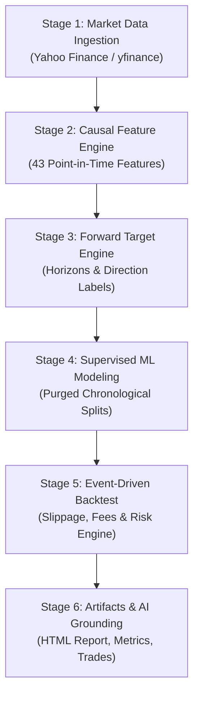

# TRADY Phase 3: Real Historical Quantitative Research & Pipeline Orchestration

## 1. Overview & Research Architecture

TRADY Phase 3 brings together the complete historical market data and quantitative modeling workflow. It transitions TRADY from single-component testing to an **end-to-end reproducible quantitative research platform** operating on real historical market data.

### Guiding Principles:
1. **Strict Research Sandbox**: Educational and historical research only. All signals, fills, and executions are virtual paper-trading simulations. Real-money broker APIs do not exist and are forbidden by the active safety firewall.
2. **Point-in-Time Causality**: All 43 technical features are strictly calculated looking backwards. Forward-looking labels are completely isolated from feature stores.
3. **Purged Chronological Splitting**: Train/validation/test partitions are strictly chronological with purge gaps equal to the forecast horizon to eliminate cross-fold information leakage.
4. **Transparent Risk Audit**: Every simulated order undergoes pre-trade risk inspection (maximum position sizing, portfolio leverage caps, and drawdown circuit breaker).
5. **Local AI Assistant Grounding**: Model weights, backtest equity curves, and performance metrics are stored on disk in standard formats (Parquet, JSON, Joblib) so TRADY AI can inspect, audit, and explain findings using allowlisted tools.

---

## 2. Research Stages Workflow



---

## 3. Command-Line Interface (CLI)

### 3.1 Single Symbol and Batch Market Data Ingestion
```powershell
# Preview NIFTY 50 (dry-run, no disk writes)
uv run trade9 data download --symbol ^NSEI --start 2023-01-01 --end 2024-01-01 --preview

# Ingest and normalize daily bars for NIFTY 50
uv run trade9 data download --symbol ^NSEI --start 2023-01-01 --end 2024-01-01

# Batch download top liquid constituents using predefined basket
uv run trade9 data download --basket nifty50_top5 --start 2023-01-01 --end 2024-01-01

# Inspect and validate ingested dataset
uv run trade9 data inspect data/processed/nsei_1d.parquet
uv run trade9 data validate data/processed/nsei_1d.parquet
```

### 3.2 End-to-End Research Pipeline Orchestration
Run the entire research workflow (Download $\to$ Features $\to$ Targets $\to$ Model $\to$ Backtest) in a single command:
```powershell
# Run research pipeline from scratch for NIFTY 50
uv run trade9 pipeline run --symbol ^NSEI --start 2023-01-01 --end 2024-01-01 --model logistic_regression

# Run research pipeline reusing an existing validated dataset
uv run trade9 pipeline run --dataset data/processed/nsei_1d.parquet --model random_forest --target target_binary_up_5d
```

### 3.3 Inspect Results with TRADY AI Assistant
```powershell
# Check local Ollama assistant status
uv run trade9 assistant status

# Ask the assistant to inspect datasets
uv run trade9 assistant ask "What datasets are currently available in data/processed and data/targets?"

# Ask the assistant to explain the latest backtest report
uv run trade9 assistant ask "Explain our latest backtest report and summarize key risk metrics."
```

---

## 4. Predefined Ticker Baskets

| Basket Name | Tickers Included | Description |
| :--- | :--- | :--- |
| `nifty50_top5` | `^NSEI`, `RELIANCE.NS`, `TCS.NS`, `HDFCBANK.NS`, `INFY.NS`, `ICICIBANK.NS` | Top 5 heavyweights and benchmark index for the National Stock Exchange of India. |
| `us_tech_top5` | `SPY`, `AAPL`, `MSFT`, `NVDA`, `AMZN`, `GOOGL` | S&P 500 ETF and mega-cap US technology benchmark. |

---

## 5. Artifact Directory Outputs

```
data/
├── raw/
│   └── <slug>_<interval>_<start>_<end>_raw.json   # Raw payload + UTC provenance
├── processed/
│   ├── <slug>_<interval>.parquet                 # Normalized canonical OHLCV bars
│   └── <slug>_<interval>.meta.json               # Schema & checksum metadata
├── features/
│   └── <slug>_<interval>_features.parquet        # 43 causal point-in-time features
└── targets/
    └── <slug>_<interval>_labeled.parquet         # Paired features and forward targets

models/
└── <model_id>.joblib                             # Serialized model, weights & metadata

reports/
└── backtests/
    └── run_<timestamp>/
        ├── metrics.json                          # Sharpe, Drawdown, CAGR, Win Rate
        ├── equity_curve.parquet                  # Bar-by-bar portfolio equity
        ├── trades.parquet                        # Executed paper trades & slippage
        ├── risk_decisions.parquet                # Pre-trade audit approvals/rejections
        └── report.html                           # Interactive research tear-sheet
```
